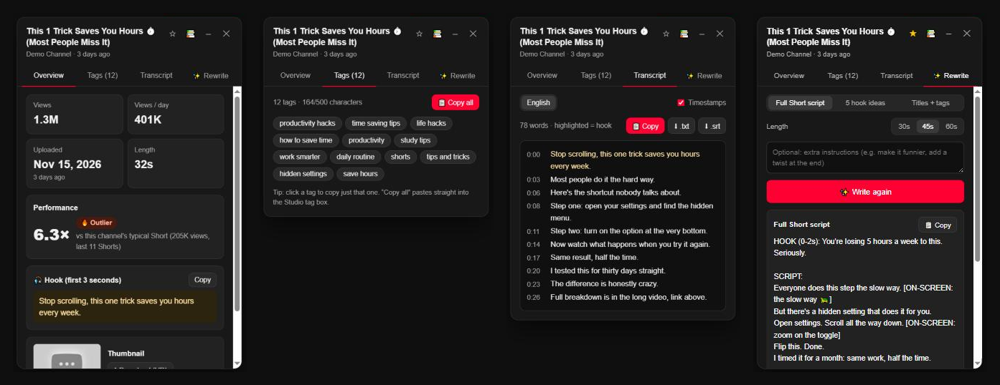
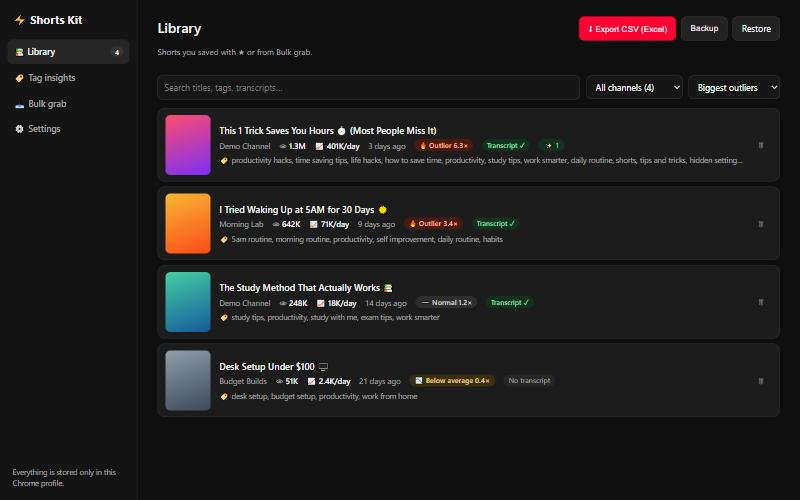
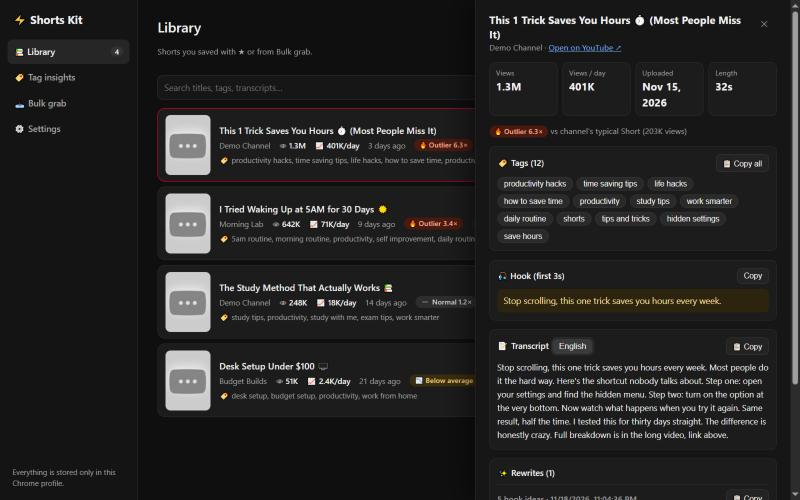
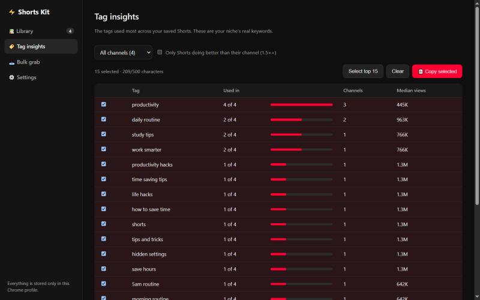

<div align="center">


# Shorts Kit

**One-click research for YouTube Shorts.**
Transcript · YouTube Studio tags · views/day · outlier score · hook · AI rewrite with Gemini.

[](https://github.com/shipwithankit/youtube-shorts-kit/releases/latest)




</div>

---

## Why

Studying what works on Shorts means copying transcripts by hand, guessing at tags, and
eyeballing view counts. Shorts Kit puts all of it one click away, right on the Short you're watching,
and keeps a searchable library of everything you save.

## Features

| | |
|---|---|
| ⚡ **One click** | Press **⚡ Analyze Short** (or <kbd>Alt</kbd>+<kbd>T</kbd>) on any Short. The transcript is copied instantly. |
| 📝 **Transcript** | Original language or **English translation**, with or without timestamps. Copy, or download as `.txt` / `.srt`. |
| 🏷️ **Studio tags** | The hidden tags the creator typed in YouTube Studio. Copy one, or all of them ready to paste into Studio (with a 500-character counter). |
| 📈 **Performance** | Views, views per day, upload date, length and an **outlier score**: how this Short did against the channel's typical Short. |
| 🎣 **Hook** | The first 3 seconds of the transcript, highlighted. |
| ✨ **AI rewrite** | Google Gemini turns the Short into **your own script** (30/45/60s), **5 hook ideas**, or **titles + tags**, in your channel's style. |
| 📚 **Library** | Save Shorts with ★. Search, filter, sort by outliers, and export to **CSV/Excel** or a JSON backup. |
| 🏷️ **Tag insights** | The most-used tags across everything you saved. Your niche's real keywords. |
| 📥 **Bulk grab** | Paste a channel and pull tags + stats for all its Shorts in one go. |

<details>
<summary><b>More screenshots</b></summary>

<br/>

**Library**, sorted by biggest outliers


**Details** for a saved Short


**Tag insights**


<sub>Screenshots use demo data.</sub>
</details>

## Install (2 minutes)

Shorts Kit isn't on the Chrome Web Store yet, so you load it yourself:

1. **[Download the latest `shorts-kit-vX.Y.Z.zip`](https://github.com/shipwithankit/youtube-shorts-kit/releases/latest)** and unzip it
2. Open `chrome://extensions` and switch on **Developer mode** (top right)
3. Click **Load unpacked** and choose the unzipped folder (the one with `manifest.json`)
4. Refresh any open YouTube tab
5. Optional: click the 🧩 puzzle icon and **pin** Shorts Kit

> Keep the unzipped folder where it is: Chrome runs the extension from it.
> Works in Chrome, Edge, Brave and other Chromium browsers.

**Updating:** download the new zip, replace the folder's contents, then click ↻ on the extension in `chrome://extensions`.

## How to use

1. Open any Short on youtube.com and click **⚡ Analyze Short** (top right) or press <kbd>Alt</kbd>+<kbd>T</kbd>
2. The transcript is already copied. Switch tabs for **Overview**, **Tags**, **Transcript** and **✨ Rewrite**
3. Click **☆** (or <kbd>Alt</kbd>+<kbd>S</kbd>) to save it to your Library
4. Open the **📚 Library** from the panel, or click the toolbar icon anywhere except on a Short

| Shortcut | Action |
|---|---|
| <kbd>Alt</kbd>+<kbd>T</kbd> | Analyze the current Short |
| <kbd>Alt</kbd>+<kbd>S</kbd> | Save / unsave it |
| <kbd>Esc</kbd> | Close the panel |

### Set up AI rewrites (optional, free)

1. Get a free API key at **[aistudio.google.com/apikey](https://aistudio.google.com/apikey)**
2. Library → **⚙️ Settings** → paste the key → **Check key & load models** → **Save settings**
3. Write a few lines in **My channel style** (language, tone, niche, how your Shorts end).
   Every rewrite follows it.

Your key is stored only in your browser and is sent only to Google's Gemini API.

## How it works

- **Transcript:** YouTube serves caption files only to its own video player. When you click,
  Shorts Kit briefly asks the player to load captions (exactly like pressing **CC**), reads the
  same file, and puts your CC setting back. English uses YouTube's built-in caption translation.
- **Tags & stats:** read from the data YouTube already sends to the player. Tags exist there
  but aren't shown on the page.
- **Outlier score:** this Short's views ÷ the median views of the channel's latest Shorts.
  🔥 3×+ · 📈 1.5×+ · ➖ normal · 📉 below 0.6×.
- **Bulk grab:** reads the channel's public Shorts tab and each Short's public watch page.

Everything runs in your browser. No server, no account, no analytics.

## Privacy

Shorts Kit collects **nothing**. Your library and settings live in Chrome's local extension
storage on your computer. The only network requests go to YouTube (to read the page you're on)
and, only when you click ✨ Rewrite, to Google's Gemini API with the transcript and your key.
Details: [PRIVACY.md](PRIVACY.md).

## Limitations

- A Short with **no captions** (none uploaded, none auto-generated) has no transcript. Tags and stats still work.
- Bulk grab gets tags and stats, but not transcripts (those need the video player).
- Shorts Kit reads YouTube's page structure. If YouTube changes it, an update may be needed.
  [Open an issue](https://github.com/shipwithankit/youtube-shorts-kit/issues) if something breaks.

## Project structure

```
manifest.json      Chrome extension config (Manifest V3)
inject.js          Runs inside YouTube's page: talks to the player, reads captions, tags, stats
content.js/.css    The ⚡ button and the side panel
shared.js          Helpers: formatting, storage, CSV, Gemini prompts
library.html/.css/.js   Library, Tag insights, Bulk grab, Settings
background.js      Toolbar icon, downloads, Gemini requests
icons/             Extension icons
```

No build step and no dependencies: edit a file, click ↻ in `chrome://extensions`, refresh YouTube.

## Contributing

Bug reports and ideas are welcome: [open an issue](https://github.com/shipwithankit/youtube-shorts-kit/issues/new/choose).
Pull requests too. Please keep it dependency-free and test on a few real Shorts.

## License

[MIT](LICENSE). Free to use, modify and share.

<sub>Shorts Kit is an independent project and is not affiliated with, endorsed by, or sponsored by YouTube or Google.
YouTube is a trademark of Google LLC. Use it responsibly and respect creators' work: study what works, then make your own.</sub>
